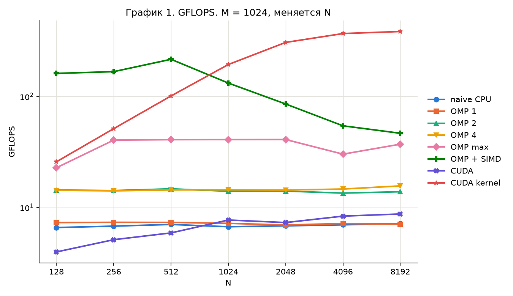
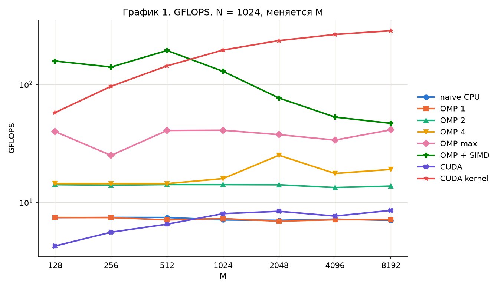
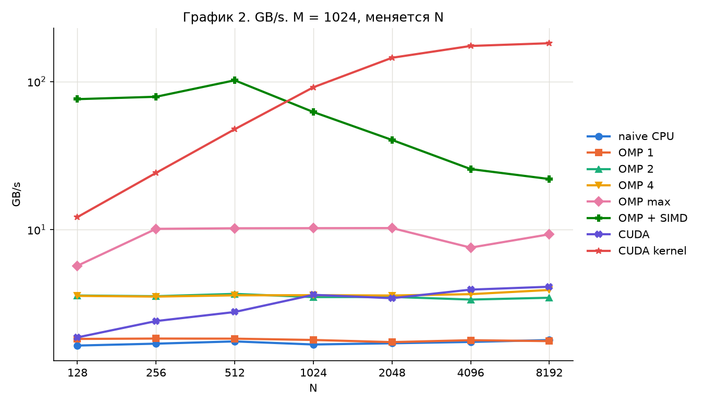
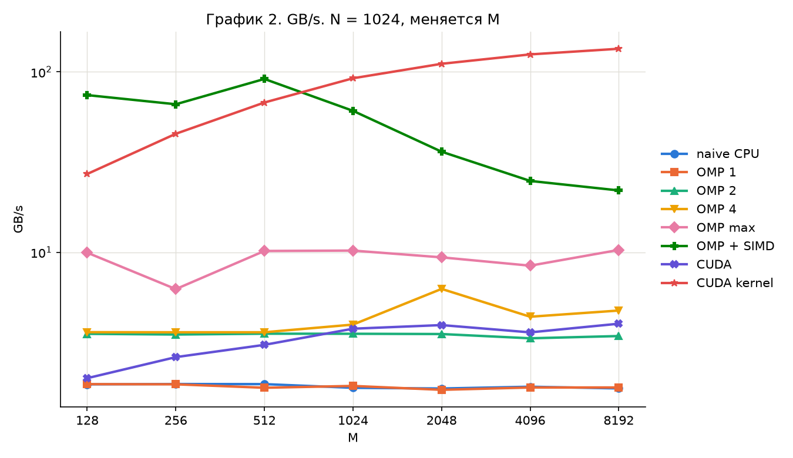
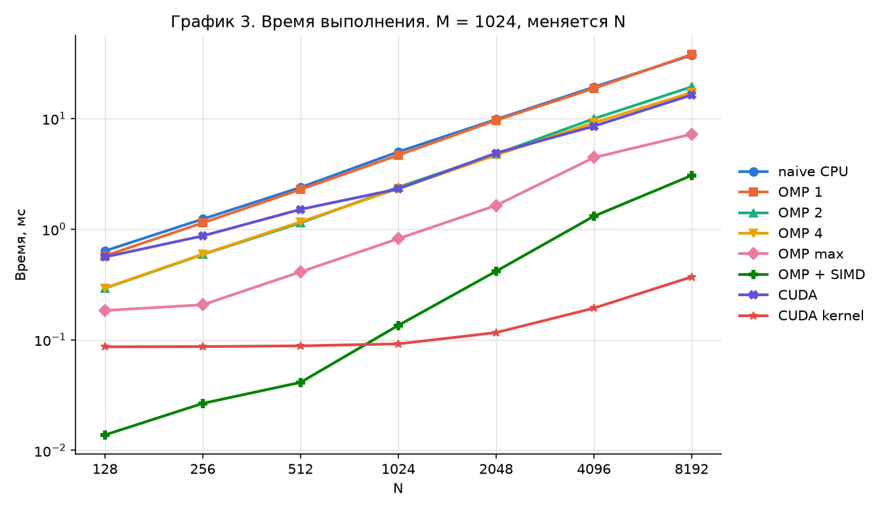
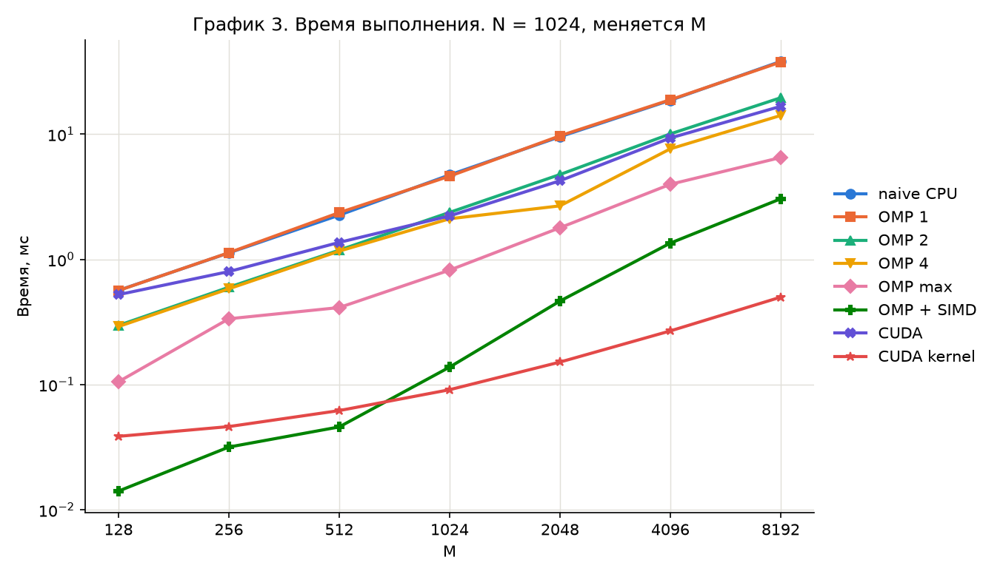
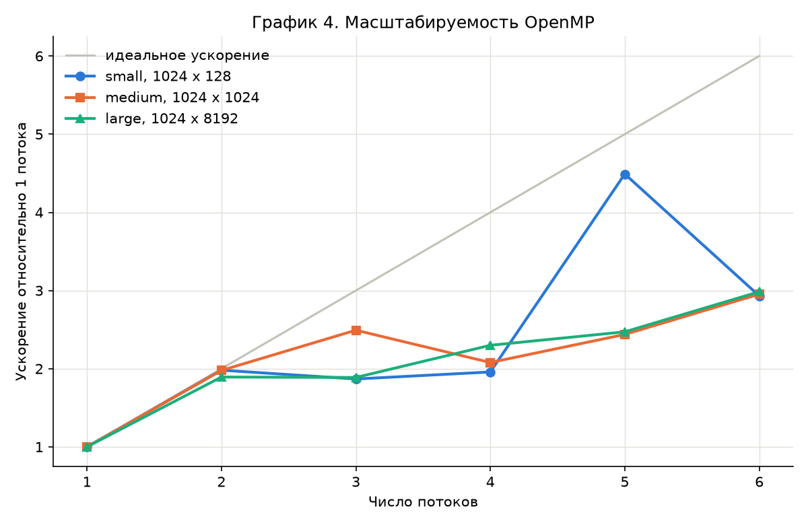

# Лабораторная работа 1. Softmax

CPU: Intel Core i5-12400F (6 ядер, 12 потоков). GPU: NVIDIA GeForce RTX 3070. Компиляторы: MSVC 14.44, nvcc 12.6.

## 1. Цель работы

Реализовать построчный softmax на CPU и GPU и сравнить производительность версий.

## 2. Формула

out[i][j] = exp(x[i][j]) / sum_k exp(x[i][k])

## 3. Реализация

naive: сумма exp по строке, затем деление.
OMP: то же, строки распределяются по потокам (parallel for). 1, 2, 4 и 12 потоков.
OMP + SIMD: 12 потоков, AVX2 по 8 элементов, exp считается один раз. Интринсики нужны, потому что при /fp:precise MSVC не векторизует std::exp даже с omp simd.
CUDA: один блок на строку, 256 потоков в блоке, частичные суммы собираются в shared-памяти.

cuDNN: готовый `cudnnSoftmaxForward` в режиме `CUDNN_SOFTMAX_ACCURATE`. Матрица передаётся как тензор `[M, N, 1, 1]`, Softmax считается по каналам, то есть по столбцам каждой строки. Настройка дескриптора выполняется до запуска таймера. Выделение буферов и копирование измеряются так же, как в CUDA-версии. Для сборки с cuDNN нужно добавить `-DCUDNN_ROOT=C:/path/to/cudnn` к первой команде ниже и добавить папку `bin` из cuDNN в `PATH`. [Документация NVIDIA](https://docs.nvidia.com/deeplearning/cudnn/backend/v9.5.1/api/cudnn-ops-library.html#cudnnsoftmaxforward)

OMP + SIMD:

    const __m256 e = _mm256_exp_ps(_mm256_loadu_ps(row_in + j));
    _mm256_storeu_ps(row_out + j, e);
    acc = _mm256_add_ps(acc, e);

CUDA:

    row_out[i] = expf(row_in[i]);
    part_sum += row_out[i];

Сборка из корня проекта в x64 Native Tools Command Prompt for VS 2022. Нужны CMake 3.31+, Ninja и CUDA Toolkit. Профиль Release, флаги /O2 и /openmp:experimental, архитектура CUDA 86.

    cmake -B build -G Ninja -DCMAKE_BUILD_TYPE=Release
    cmake --build build --target lab_1
    build\tasks\lab_1\lab_1.exe

## 4. Корректность

Эталон: naive на том же входе. Максимум по всем размерам:

| Версия | Макс. абсолютная ошибка | Макс. относительная ошибка |
|---|---|---|
| OMP 1, 2, 4, max | 0 | 0 |
| OMP + SIMD | 1.304e-08 | 4.836e-06 |
| CUDA | 7.451e-09 | 5.174e-06 |

## 5. Обоснование метрик

- `t` — медиана 10 замеров после 3 прогревочных запусков, в мс. На CPU таймер запускается после выделения выходного вектора. Для CUDA измерял полное время вызова с выделением памяти и копированием, а также отдельно время кернела через CUDA events.
- GFLOPS — оценка числа операций в секунду в миллиардах. В таблице один `exp` условно считается за 15 операций. Получается 32 операции на элемент для naive и OMP (два `exp`, сложение и деление) и 17 для OMP + SIMD и CUDA (один `exp` и две операции). Формула с временем в мс: `M * N * операций_на_элемент / (t * 10^6)`.
- GB/s — эффективная пропускная способность по объёму входа и выхода: `2 * M * N * 4 / (t * 10^6)`. Дополнительные обращения к памяти в этот объём не входят.
- `S = t_naive / t_версии` — ускорение относительно naive CPU. Для графика масштабируемости использовал `t_OMP1 / t_OMPp`, где `p` — число потоков.

## 6. Таблицы замеров

Таблица 1. Время выполнения t (мс)

Время всех версий взято из одного прогона с cuDNN 9.5.1 на RTX 3070. Столбцы «целиком» включают выделение буферов и копирование в обе стороны. Столбцы «на GPU» показывают время по CUDA events. Таблицы 2–4 и графики относятся к исходному прогону.

M = 1024, меняется N

| M x N | naive CPU | OMP 1 | OMP 2 | OMP 4 | OMP max | OMP + SIMD | CUDA целиком | CUDA на GPU | cuDNN целиком | cuDNN на GPU |
|---|---:|---:|---:|---:|---:|---:|---:|---:|---:|---:|
| 1024 x 128 | 0.6198 | 0.6689 | 0.4663 | 0.1629 | 0.1056 | 0.0182 | 0.4827 | 0.0838 | 0.2162 | 0.0277 |
| 1024 x 256 | 1.2652 | 1.3519 | 0.6001 | 0.5859 | 0.2092 | 0.0248 | 0.8214 | 0.0887 | 0.7417 | 0.0335 |
| 1024 x 512 | 2.5243 | 2.6273 | 1.1900 | 1.1677 | 0.4423 | 0.0669 | 1.3065 | 0.0862 | 1.3512 | 0.0339 |
| 1024 x 1024 | 5.3558 | 8.3698 | 2.4415 | 1.3688 | 0.9331 | 0.1949 | 2.2442 | 0.0908 | 2.2234 | 0.0496 |
| 1024 x 2048 | 13.6103 | 10.0990 | 5.1813 | 3.2376 | 2.0210 | 0.4061 | 4.7141 | 0.1127 | 4.5684 | 0.0814 |
| 1024 x 4096 | 19.2190 | 19.2892 | 10.1445 | 5.5514 | 3.5144 | 1.3363 | 8.6592 | 0.1954 | 9.9152 | 0.2196 |
| 1024 x 8192 | 43.7430 | 38.4352 | 21.5942 | 13.4449 | 7.8872 | 3.1112 | 16.9501 | 0.4139 | 17.8913 | 0.5261 |

N = 1024, меняется M

| M x N | naive CPU | OMP 1 | OMP 2 | OMP 4 | OMP max | OMP + SIMD | CUDA целиком | CUDA на GPU | cuDNN целиком | cuDNN на GPU |
|---|---:|---:|---:|---:|---:|---:|---:|---:|---:|---:|
| 128 x 1024 | 0.6203 | 0.5975 | 0.3178 | 0.2910 | 0.1060 | 0.0152 | 0.4747 | 0.0373 | 0.1960 | 0.0306 |
| 256 x 1024 | 1.2027 | 1.1697 | 0.5973 | 0.5839 | 0.3002 | 0.0364 | 0.7891 | 0.0454 | 0.8331 | 0.0362 |
| 512 x 1024 | 2.4552 | 2.3712 | 1.2873 | 1.1674 | 0.4146 | 0.0481 | 1.3117 | 0.0608 | 1.2904 | 0.0392 |
| 1024 x 1024 | 4.9740 | 4.8120 | 2.5615 | 2.3867 | 0.8304 | 0.1341 | 2.3507 | 0.0912 | 2.4959 | 0.0514 |
| 2048 x 1024 | 10.5123 | 9.5056 | 5.0274 | 4.2972 | 1.9875 | 0.4340 | 4.3668 | 0.1492 | 4.7832 | 0.0731 |
| 4096 x 1024 | 19.2832 | 19.8734 | 10.1342 | 5.6651 | 3.6508 | 1.3298 | 8.8275 | 0.3090 | 8.9417 | 0.1178 |
| 8192 x 1024 | 42.0321 | 38.6150 | 20.6769 | 15.2549 | 6.8976 | 3.5798 | 17.1862 | 0.5823 | 16.4919 | 0.2828 |

Таблица 2. Производительность GFLOPS

M = 1024, меняется N

| M x N | naive CPU | OMP 1 | OMP 2 | OMP 4 | OMP max | OMP + SIMD | CUDA | CUDA kernel |
|---|---|---|---|---|---|---|---|---|
| 1024 x 128 | 6.60 | 7.31 | 14.36 | 14.28 | 22.81 | 161.47 | 3.98 | 25.82 |
| 1024 x 256 | 6.80 | 7.36 | 14.21 | 14.12 | 40.49 | 167.54 | 5.13 | 51.34 |
| 1024 x 512 | 7.04 | 7.34 | 14.73 | 14.40 | 40.84 | 216.33 | 5.90 | 101.17 |
| 1024 x 1024 | 6.71 | 7.20 | 14.01 | 14.43 | 40.91 | 132.14 | 7.71 | 194.18 |
| 1024 x 2048 | 6.84 | 6.96 | 14.05 | 14.36 | 40.97 | 85.62 | 7.32 | 307.08 |
| 1024 x 4096 | 6.98 | 7.17 | 13.49 | 14.67 | 30.24 | 54.45 | 8.36 | 369.06 |
| 1024 x 8192 | 7.19 | 7.07 | 13.87 | 15.65 | 37.19 | 46.64 | 8.74 | 385.01 |

N = 1024, меняется M

| M x N | naive CPU | OMP 1 | OMP 2 | OMP 4 | OMP max | OMP + SIMD | CUDA | CUDA kernel |
|---|---|---|---|---|---|---|---|---|
| 128 x 1024 | 7.41 | 7.43 | 14.12 | 14.42 | 39.79 | 158.03 | 4.26 | 57.73 |
| 256 x 1024 | 7.44 | 7.42 | 14.00 | 14.41 | 25.00 | 140.58 | 5.57 | 96.46 |
| 512 x 1024 | 7.43 | 7.09 | 14.15 | 14.41 | 40.67 | 194.18 | 6.52 | 143.76 |
| 1024 x 1024 | 7.09 | 7.26 | 14.13 | 15.89 | 40.88 | 129.27 | 8.01 | 195.89 |
| 2048 x 1024 | 7.03 | 6.91 | 14.09 | 25.06 | 37.49 | 76.72 | 8.39 | 235.64 |
| 4096 x 1024 | 7.19 | 7.12 | 13.34 | 17.57 | 33.71 | 52.83 | 7.64 | 265.66 |
| 8192 x 1024 | 7.04 | 7.12 | 13.73 | 19.01 | 41.22 | 46.79 | 8.54 | 285.50 |

Таблица 3. Пропускная способность GB/s

M = 1024, меняется N

| M x N | naive CPU | OMP 1 | OMP 2 | OMP 4 | OMP max | OMP + SIMD | CUDA | CUDA kernel |
|---|---|---|---|---|---|---|---|---|
| 1024 x 128 | 1.65 | 1.83 | 3.59 | 3.57 | 5.70 | 75.98 | 1.87 | 12.15 |
| 1024 x 256 | 1.70 | 1.84 | 3.55 | 3.53 | 10.12 | 78.84 | 2.41 | 24.16 |
| 1024 x 512 | 1.76 | 1.84 | 3.68 | 3.60 | 10.21 | 101.80 | 2.78 | 47.61 |
| 1024 x 1024 | 1.68 | 1.80 | 3.50 | 3.61 | 10.23 | 62.18 | 3.63 | 91.38 |
| 1024 x 2048 | 1.71 | 1.74 | 3.51 | 3.59 | 10.24 | 40.29 | 3.44 | 144.51 |
| 1024 x 4096 | 1.74 | 1.79 | 3.37 | 3.67 | 7.56 | 25.62 | 3.93 | 173.68 |
| 1024 x 8192 | 1.80 | 1.77 | 3.47 | 3.91 | 9.30 | 21.95 | 4.11 | 181.18 |

N = 1024, меняется M

| M x N | naive CPU | OMP 1 | OMP 2 | OMP 4 | OMP max | OMP + SIMD | CUDA | CUDA kernel |
|---|---|---|---|---|---|---|---|---|
| 128 x 1024 | 1.85 | 1.86 | 3.53 | 3.61 | 9.95 | 74.37 | 2.00 | 27.17 |
| 256 x 1024 | 1.86 | 1.85 | 3.50 | 3.60 | 6.25 | 66.16 | 2.62 | 45.39 |
| 512 x 1024 | 1.86 | 1.77 | 3.54 | 3.60 | 10.17 | 91.38 | 3.07 | 67.65 |
| 1024 x 1024 | 1.77 | 1.82 | 3.53 | 3.97 | 10.22 | 60.83 | 3.77 | 92.18 |
| 2048 x 1024 | 1.76 | 1.73 | 3.52 | 6.27 | 9.37 | 36.10 | 3.95 | 110.89 |
| 4096 x 1024 | 1.80 | 1.78 | 3.34 | 4.39 | 8.43 | 24.86 | 3.60 | 125.02 |
| 8192 x 1024 | 1.76 | 1.78 | 3.43 | 4.75 | 10.30 | 22.02 | 4.02 | 134.35 |

Таблица 4. Ускорение относительно наивной реализации

M = 1024, меняется N

| M x N | naive CPU | OMP 1 | OMP 2 | OMP 4 | OMP max | OMP + SIMD | CUDA | CUDA kernel |
|---|---|---|---|---|---|---|---|---|
| 1024 x 128 | 1.00 | 1.11 | 2.18 | 2.16 | 3.46 | 46.07 | 1.14 | 7.37 |
| 1024 x 256 | 1.00 | 1.08 | 2.09 | 2.08 | 5.96 | 46.41 | 1.42 | 14.22 |
| 1024 x 512 | 1.00 | 1.04 | 2.09 | 2.05 | 5.80 | 57.87 | 1.58 | 27.06 |
| 1024 x 1024 | 1.00 | 1.07 | 2.09 | 2.15 | 6.10 | 37.08 | 2.16 | 54.49 |
| 1024 x 2048 | 1.00 | 1.02 | 2.06 | 2.10 | 5.99 | 23.58 | 2.02 | 84.56 |
| 1024 x 4096 | 1.00 | 1.03 | 1.93 | 2.10 | 4.33 | 14.68 | 2.25 | 99.53 |
| 1024 x 8192 | 1.00 | 0.98 | 1.93 | 2.18 | 5.17 | 12.22 | 2.29 | 100.85 |

N = 1024, меняется M

| M x N | naive CPU | OMP 1 | OMP 2 | OMP 4 | OMP max | OMP + SIMD | CUDA | CUDA kernel |
|---|---|---|---|---|---|---|---|---|
| 128 x 1024 | 1.00 | 1.00 | 1.91 | 1.95 | 5.37 | 40.13 | 1.08 | 14.66 |
| 256 x 1024 | 1.00 | 1.00 | 1.88 | 1.94 | 3.36 | 35.56 | 1.41 | 24.40 |
| 512 x 1024 | 1.00 | 0.95 | 1.90 | 1.94 | 5.47 | 49.17 | 1.65 | 36.40 |
| 1024 x 1024 | 1.00 | 1.02 | 1.99 | 2.24 | 5.76 | 34.32 | 2.13 | 52.00 |
| 2048 x 1024 | 1.00 | 0.98 | 2.00 | 3.57 | 5.33 | 20.55 | 2.25 | 63.11 |
| 4096 x 1024 | 1.00 | 0.99 | 1.86 | 2.44 | 4.69 | 13.83 | 2.00 | 69.57 |
| 8192 x 1024 | 1.00 | 1.01 | 1.95 | 2.70 | 5.86 | 12.52 | 2.28 | 76.37 |

## 7. Графики

График 1. GFLOPS от размера задачи

График 2. GB/s от размера задачи

После 1024 × 512 у OMP + SIMD падают и GFLOPS, и GB/s, потому что обе метрики зависят от времени на элемент. Вход и выход вместе вырастают с 4 до 64 МиБ. Думаю, на больших размерах данные хуже помещаются в кэш CPU и больше времени уходит на работу с памятью.

График 3. Время выполнения от размера задачи

На 1024 × 128 полная CUDA-версия занимает 0,5600 мс, сам кернел — 0,0863 мс, а OMP + SIMD — 0,0138 мс. На таком размере CPU быстро обрабатывает строки в нескольких потоках и считает `exp` сразу для восьми элементов. В CUDA на каждом вызове выделяется память, данные копируются на GPU и обратно, а запуск кернела требует синхронизации. При длине строки 128 из 256 потоков блока только половина считает `exp`, а частичные суммы всё равно складывает каждый поток. При росте N с 128 до 512 время кернела почти не меняется (0,086–0,088 мс), поэтому его GFLOPS и GB/s растут.

График 4. Ускорение OpenMP относительно 1 потока

На 6 потоках ускорение около 3 раз, а на малой матрице на 5 потоках есть скачок примерно до 4,5. На коротких запусках накладные расходы OpenMP и планирование потоков могут заметно влиять на результат. По одному прогону я бы не делал вывод, что 5 потоков лучше 6.

## 8. Выводы

По полному времени быстрее всего оказался OMP + SIMD. На 1024 × 8192 кернел CUDA занимает 0,4139 мс, а весь CUDA-вызов — 16,9501 мс. Я бы сначала проверил, сколько удастся выиграть, если переиспользовать буферы и оставить данные на GPU между операциями.

### Сравнение с cuDNN

На 8192 × 1024 cuDNN считает примерно вдвое быстрее моего кернела, а полное время у двух GPU-версий почти одинаковое. При том же числе элементов и более длинных строках быстрее оказался мой кернел. На маленькой матрице OMP + SIMD всё ещё выигрывает по полному времени. Максимальная относительная ошибка cuDNN по всем размерам составила 4,835e-6, абсолютная — 1,118e-8.

## 9. Приложение

https://github.com/Egor1dzeN-learn/gpu-2026
