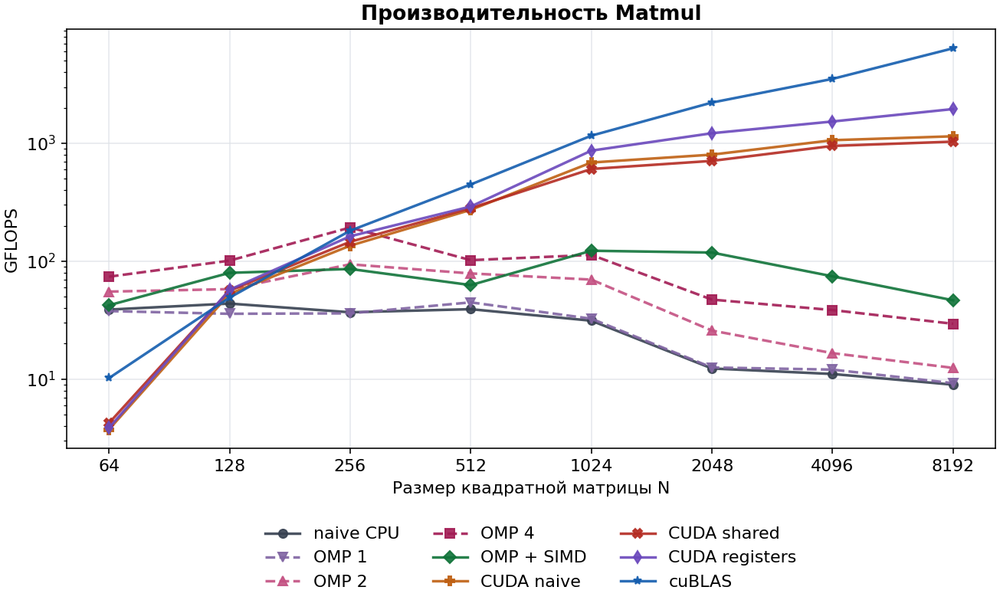
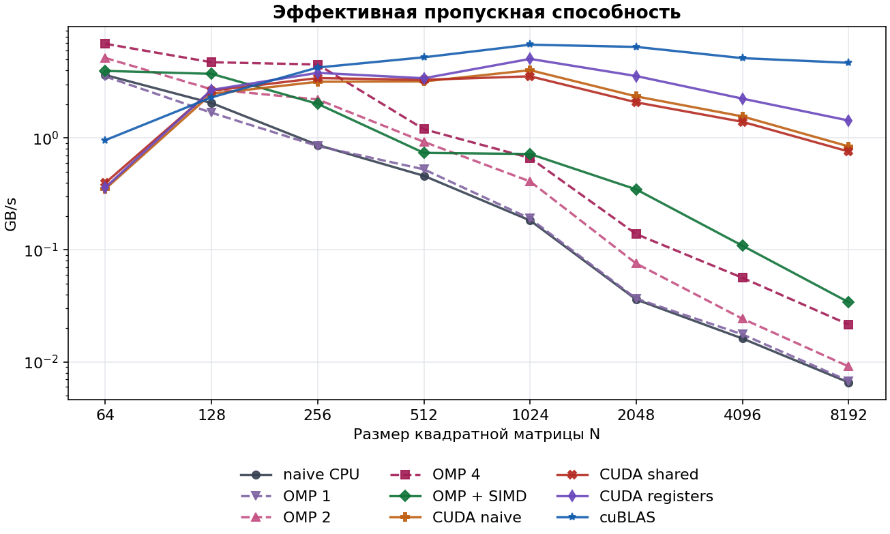
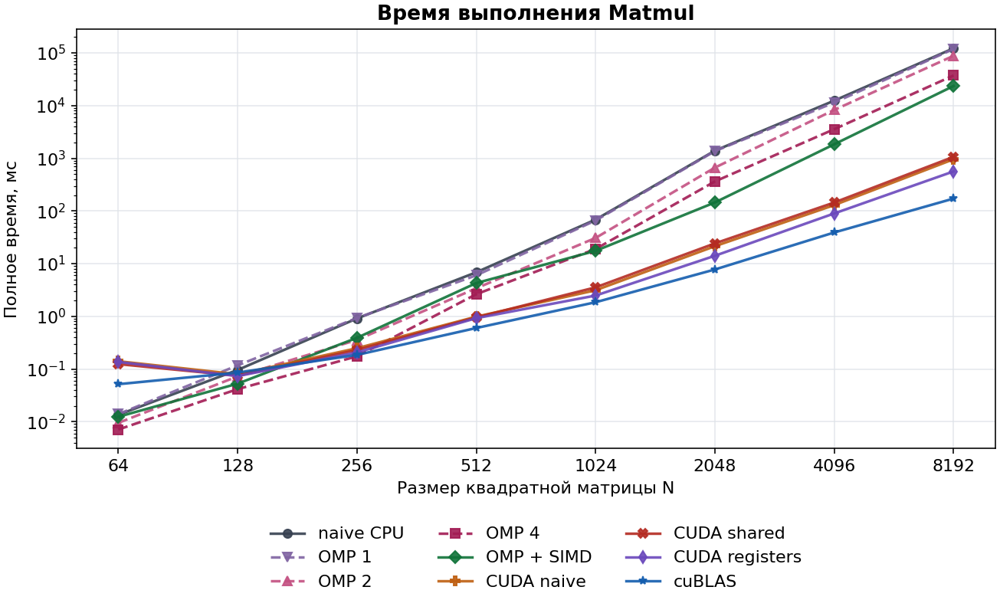
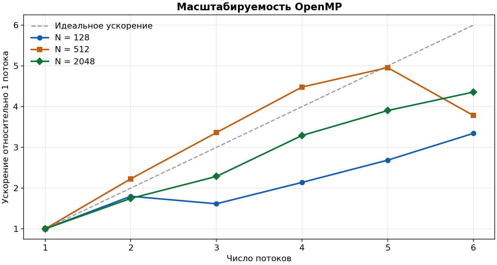

# Лабораторная работа 2. Matmul

## 1. Цель работы

Реализовать умножение матриц на CPU и GPU. Сравнить влияние OpenMP, векторизации, shared memory и блокирования по регистрам. Для сравнения с библиотечной реализацией использовал cuBLAS.

## 2. Формула

`C[i, j] = sum(A[i, k] * B[k, j], k = 0..K-1)`.

Размеры матриц `A[M, K]`, `B[K, N]` и `C[M, N]`. Все данные в FP32, хранение построчное. В замерах `M = K = N`.

## 3. Реализация

Все версии наследуют `AbstractMatmul`. Бенчмарк вызывает один и тот же метод `run(a, b, c)`. Для GPU копирование и замер времени находятся в `GpuMatmul::run`, а каждое ядро и cuBLAS переопределяют `launch`.

- **naive CPU.** Три цикла в порядке `i, k, j`, чтобы читать строки `B` последовательно. Явных SIMD-инструкций в этой версии нет, автоматическая векторизация компилятора разрешена.
- **OpenMP.** Тот же расчёт, строки распределяются статически между 1, 2 или 4 потоками.
- **OMP + SIMD.** 6 потоков, блокирование по размерам 16 × 64 × 128, AVX2 и FMA по 8 элементов строки за раз.
- **CUDA naive.** Один поток на элемент результата, операнды читаются из глобальной памяти.
- **CUDA shared.** Блок 16 × 16 переносит плитки матриц в shared memory и переиспользует их внутри блока.
- **CUDA registers.** Каждый поток накапливает 2 × 2 элемента в регистрах, блок считает плитку результата 32 × 32.
- **cuBLAS.** `cublasSgemm` в режиме `CUBLAS_PEDANTIC_MATH`. Библиотека видит построчные буферы как транспонированные представления, поэтому вычисляет `Cᵀ = Bᵀ · Aᵀ` без перекладки данных.

Ключевая операция SIMD:

```cpp
const __m256 sum = _mm256_loadu_ps(c_row + j);
const __m256 rhs = _mm256_loadu_ps(b_row + j);
_mm256_storeu_ps(c_row + j, _mm256_fmadd_ps(value, rhs, sum));
```

Один шаг накопления в CUDA с блокированием по регистрам:

```cpp
sum00 += a0 * b0;
sum01 += a0 * b1;
sum10 += a1 * b0;
sum11 += a1 * b1;
```

Замеры выполнены на Intel Core i5-12400F (6 ядер, 12 потоков) и NVIDIA RTX 3070 (8 ГБ), Windows 11. Сборка Release, MSVC 14.44 (`/O2`, `/arch:AVX2`, `/openmp:experimental`), CUDA 12.6 (`nvcc 12.6.20`), cuBLAS 12.6.0.22.

Команды из корня проекта в x64 Native Tools Command Prompt for VS 2022:

```bat
cmake -S . -B build -G Ninja -DCMAKE_BUILD_TYPE=Release
cmake --build build --target lab_2
build\tasks\lab_2\lab_2.exe > matmul.csv
```

Параметр `512` ограничивает запуск размерами до 512. Полный прогон до 8192 на этой машине занял около 15 минут, в основном из-за больших CPU-замеров.

## 4. Корректность

Входы одинаковы для всех версий, элементы равномерно распределены в диапазоне от −1 до 1 (seed 42). Эталон — naive CPU. Для каждого размера сравниваются все элементы результата. Абсолютная ошибка равна `abs(C - C_ref)`, относительная — `abs(C - C_ref) / max(abs(C_ref), 1e-7)`.

| Версия | Макс. абсолютная ошибка | Макс. относительная ошибка |
|---|---:|---:|
| OMP 1 | 0.000e+00 | 0.000e+00 |
| OMP 2 | 0.000e+00 | 0.000e+00 |
| OMP 4 | 0.000e+00 | 0.000e+00 |
| OMP + SIMD | 1.144e-04 | 7.931e+01 |
| CUDA naive | 1.144e-04 | 7.931e+01 |
| CUDA shared | 1.144e-04 | 7.931e+01 |
| CUDA registers | 1.144e-04 | 7.931e+01 |
| cuBLAS | 4.044e-04 | 1.610e+02 |

Около нуля знаменатель мал, поэтому максимум относительной ошибки может быть большим даже при малой абсолютной ошибке. Разный порядок сложений и FMA тоже влияют на округление.

## 5. Метрики

- `t` — медиана после одного прогревочного запуска. Для CPU на 4096 и 8192 выполнен один замер после прогрева, для остальных случаев — три. GPU-версии используют заранее выделенные буферы. Полное время включает копирование двух входов на GPU и результата обратно. Время вычисления измеряется CUDA events.
- GFLOPS — `2 * M * K * N / (t * 10^6)`, где `t` в мс. На один шаг скалярного произведения считаются умножение и сложение.
- GB/s — `4 * (M * K + K * N + M * N) / (t * 10^6)`. Это эффективная скорость по размеру двух входов и выхода. Реальные повторные чтения в формулу не входят.
- Ускорение — `t_naive / t`. Для графика масштабируемости OpenMP — `t_OMP1 / t_OMPp` для `p` потоков.

## 6. Результаты замеров

**Время, мс.** Для GPU в каждой ячейке указаны полное время и время вычисления на GPU.

| N | naive CPU | OMP 1 | OMP 2 | OMP 4 | OMP + SIMD | CUDA naive | CUDA shared | CUDA registers | cuBLAS |
|---:|---:|---:|---:|---:|---:|---:|---:|---:|---:|
| 64 | 0.0135 | 0.0139 | 0.0095 | 0.0071 | 0.0124 | 0.1404 / 0.0358 | 0.1240 / 0.0297 | 0.1362 / 0.0389 | 0.0515 / 0.0184 |
| 128 | 0.0960 | 0.1172 | 0.0724 | 0.0415 | 0.0527 | 0.0794 / 0.0102 | 0.0745 / 0.0113 | 0.0733 / 0.0113 | 0.0855 / 0.0225 |
| 256 | 0.9106 | 0.9295 | 0.3567 | 0.1739 | 0.3907 | 0.2480 / 0.0631 | 0.2299 / 0.0674 | 0.2064 / 0.0556 | 0.1851 / 0.0381 |
| 512 | 6.8565 | 6.0017 | 3.4112 | 2.6324 | 4.2819 | 0.9853 / 0.2693 | 0.9532 / 0.3048 | 0.9231 / 0.2576 | 0.6001 / 0.0730 |
| 1024 | 68.6516 | 66.0611 | 30.7885 | 18.9988 | 17.5177 | 3.1281 / 1.7248 | 3.5480 / 2.0493 | 2.4801 / 1.0143 | 1.8517 / 0.3116 |
| 2048 | 1396.7049 | 1369.8844 | 666.3865 | 363.8529 | 145.2061 | 21.4515 / 14.3948 | 24.2338 / 17.7364 | 14.1207 / 7.6868 | 7.7572 / 1.3792 |
| 4096 | 12443.8111 | 11426.7869 | 8287.7213 | 3571.8678 | 1847.5530 | 129.4875 / 105.4756 | 144.7194 / 118.0045 | 89.8373 / 58.7174 | 39.0905 / 10.0207 |
| 8192 | 122649.3476 | 119088.6530 | 88401.2566 | 37349.9762 | 23606.7612 | 959.2975 / 852.1213 | 1064.9848 / 964.2761 | 563.5837 / 459.8833 | 172.0197 / 69.9922 |

**Производительность, GFLOPS**

| N | naive CPU | OMP 1 | OMP 2 | OMP 4 | OMP + SIMD | CUDA naive | CUDA shared | CUDA registers | cuBLAS |
|---:|---:|---:|---:|---:|---:|---:|---:|---:|---:|
| 64 | 38.84 | 37.72 | 55.19 | 73.84 | 42.28 | 3.73 | 4.23 | 3.85 | 10.18 |
| 128 | 43.69 | 35.79 | 57.93 | 101.07 | 79.59 | 52.82 | 56.30 | 57.22 | 49.06 |
| 256 | 36.85 | 36.10 | 94.07 | 192.95 | 85.88 | 135.30 | 145.95 | 162.57 | 181.28 |
| 512 | 39.15 | 44.73 | 78.69 | 101.97 | 62.69 | 272.44 | 281.62 | 290.80 | 447.32 |
| 1024 | 31.28 | 32.51 | 69.75 | 113.03 | 122.59 | 686.51 | 605.27 | 865.89 | 1159.74 |
| 2048 | 12.30 | 12.54 | 25.78 | 47.22 | 118.31 | 800.87 | 708.92 | 1216.64 | 2214.70 |
| 4096 | 11.04 | 12.03 | 16.58 | 38.48 | 74.39 | 1061.41 | 949.69 | 1529.87 | 3515.92 |
| 8192 | 8.96 | 9.23 | 12.44 | 29.44 | 46.58 | 1146.16 | 1032.42 | 1950.93 | 6391.78 |

**Эффективная пропускная способность, GB/s**

| N | naive CPU | OMP 1 | OMP 2 | OMP 4 | OMP + SIMD | CUDA naive | CUDA shared | CUDA registers | cuBLAS |
|---:|---:|---:|---:|---:|---:|---:|---:|---:|---:|
| 64 | 3.641 | 3.536 | 5.174 | 6.923 | 3.964 | 0.350 | 0.396 | 0.361 | 0.954 |
| 128 | 2.048 | 1.678 | 2.716 | 4.738 | 3.731 | 2.476 | 2.639 | 2.682 | 2.300 |
| 256 | 0.864 | 0.846 | 2.205 | 4.522 | 2.013 | 3.171 | 3.421 | 3.810 | 4.249 |
| 512 | 0.459 | 0.524 | 0.922 | 1.195 | 0.735 | 3.193 | 3.300 | 3.408 | 5.242 |
| 1024 | 0.183 | 0.190 | 0.409 | 0.662 | 0.718 | 4.023 | 3.546 | 5.074 | 6.795 |
| 2048 | 0.036 | 0.037 | 0.076 | 0.138 | 0.347 | 2.346 | 2.077 | 3.564 | 6.488 |
| 4096 | 0.016 | 0.018 | 0.024 | 0.056 | 0.109 | 1.555 | 1.391 | 2.241 | 5.150 |
| 8192 | 0.007 | 0.007 | 0.009 | 0.022 | 0.034 | 0.839 | 0.756 | 1.429 | 4.681 |

**Ускорение относительно naive CPU**

| N | naive CPU | OMP 1 | OMP 2 | OMP 4 | OMP + SIMD | CUDA naive | CUDA shared | CUDA registers | cuBLAS |
|---:|---:|---:|---:|---:|---:|---:|---:|---:|---:|
| 64 | 1.00 | 0.97 | 1.42 | 1.90 | 1.09 | 0.10 | 0.11 | 0.10 | 0.26 |
| 128 | 1.00 | 0.82 | 1.33 | 2.31 | 1.82 | 1.21 | 1.29 | 1.31 | 1.12 |
| 256 | 1.00 | 0.98 | 2.55 | 5.24 | 2.33 | 3.67 | 3.96 | 4.41 | 4.92 |
| 512 | 1.00 | 1.14 | 2.01 | 2.60 | 1.60 | 6.96 | 7.19 | 7.43 | 11.43 |
| 1024 | 1.00 | 1.04 | 2.23 | 3.61 | 3.92 | 21.95 | 19.35 | 27.68 | 37.07 |
| 2048 | 1.00 | 1.02 | 2.10 | 3.84 | 9.62 | 65.11 | 57.63 | 98.91 | 180.05 |
| 4096 | 1.00 | 1.09 | 1.50 | 3.48 | 6.74 | 96.10 | 85.99 | 138.51 | 318.33 |
| 8192 | 1.00 | 1.03 | 1.39 | 3.28 | 5.20 | 127.85 | 115.17 | 217.62 | 713.00 |

## 7. Графики

Для первых трёх графиков используется полное время.









## 8. Выводы

На 64 × 64 OpenMP с четырьмя потоками занял 0,0071 мс, а cuBLAS целиком — 0,0515 мс. Для такой маленькой задачи копирование и запуск GPU стоят больше, чем сам расчёт на CPU.

На 8192 × 8192 CUDA naive считает за 852 мс, shared memory — за 964 мс, а блокирование по регистрам — за 460 мс. Думаю, для простой плитки выигрыш от повторного использования данных съедают синхронизации и дополнительные обращения к shared memory. В регистровом варианте поток считает четыре результата за один проход по плитке.

На том же размере cuBLAS занял 70 мс на GPU и 172 мс целиком. С учётом копирования и ожидания производительность падает с 15,7 до 6,4 TFLOPS. Эффективные GB/s на больших матрицах снижаются, потому что число операций растёт как `N³`, а объём входа и выхода — как `N²`.

У naive CPU между 1024 и 8192 производительность падает с 31,28 до 8,96 GFLOPS. Матрица B вырастает примерно с 4,2 до 268,4 МБ и перестаёт помещаться в кэш. При порядке циклов `i, k, j` каждая новая строка результата требует снова прочитать B.

На 2048 × 2048 шесть потоков OpenMP дали ускорение 4,36 раза относительно одного. На 512 × 512 переход с пяти потоков на шесть снизил ускорение с 4,96 до 3,78. На этом размере замер короткий, поэтому я бы перепроверил эту точку в нескольких независимых прогонах.
