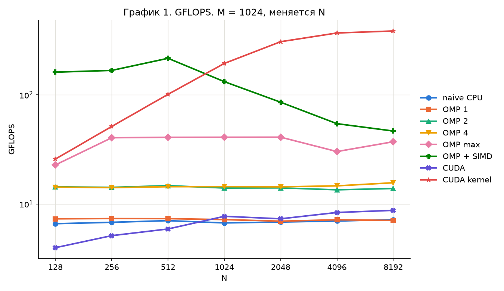
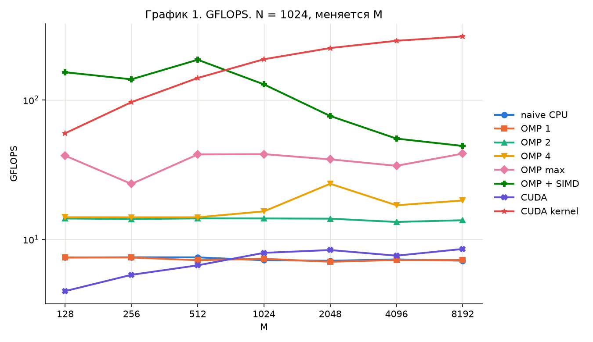
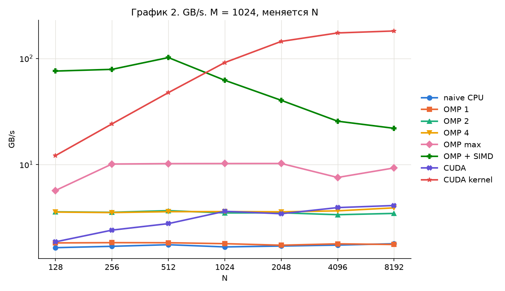
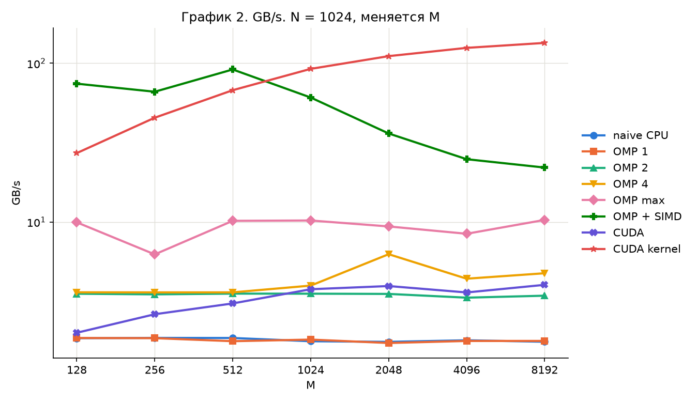
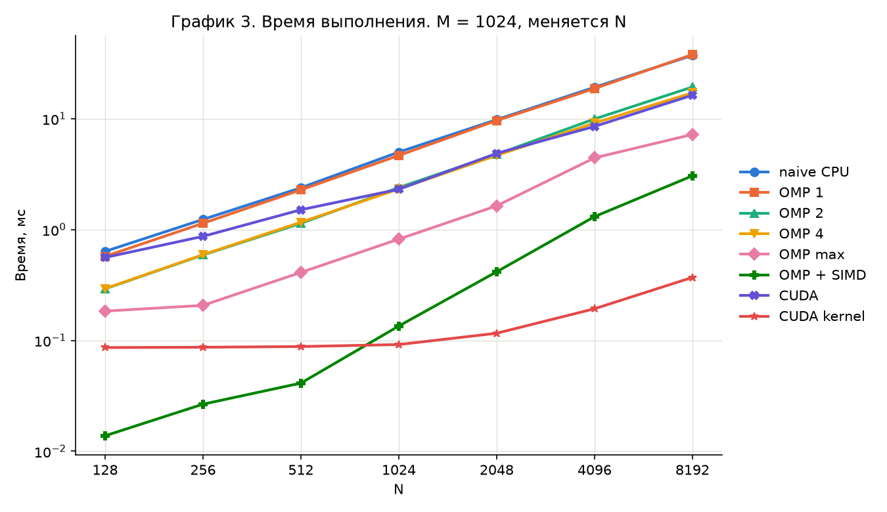
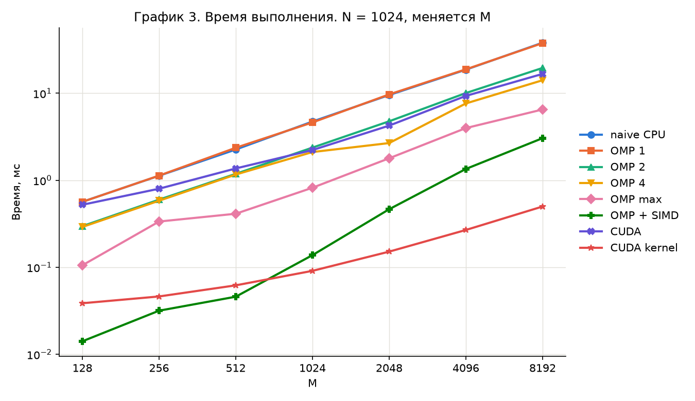
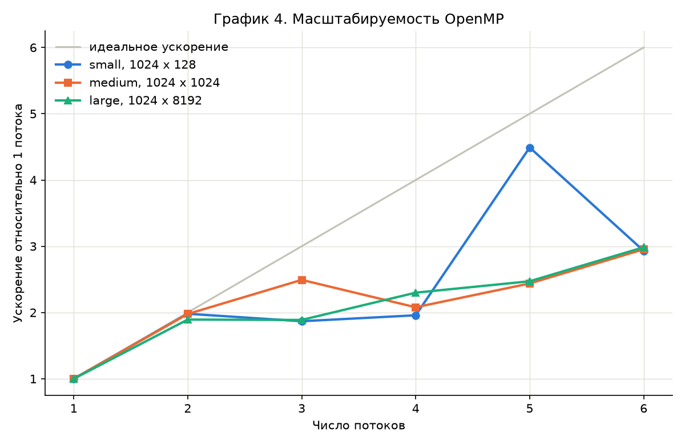

Лабораторная работа 1. Softmax

CPU: Intel Core i5-12400F (6 ядер, 12 потоков). GPU: NVIDIA GeForce RTX 3070. Компиляторы: MSVC 14.44, nvcc 12.6.

1. Цель работы

Реализовать построчный softmax на CPU и GPU и сравнить производительность версий.

2. Формула

out[i][j] = exp(x[i][j]) / sum_k exp(x[i][k])

3. Реализация

naive: сумма exp по строке, затем деление.
OMP: то же, строки распределяются по потокам (parallel for). 1, 2, 4 и 12 потоков.
OMP + SIMD: 12 потоков, AVX2 по 8 элементов, exp считается один раз. Интринсики нужны, потому что при /fp:precise MSVC не векторизует std::exp даже с omp simd.
CUDA: один блок на строку, 256 потоков в блоке, частичные суммы собираются в shared-памяти.

OMP + SIMD:

    const __m256 e = _mm256_exp_ps(_mm256_loadu_ps(row_in + j));
    _mm256_storeu_ps(row_out + j, e);
    acc = _mm256_add_ps(acc, e);

CUDA:

    row_out[i] = expf(row_in[i]);
    part_sum += row_out[i];

Сборка (Release, /O2, /openmp:experimental, CUDA architecture 86):

    cmake -B build -G Ninja -DCMAKE_BUILD_TYPE=Release
    cmake --build build --target lab_1
    build\tasks\lab_1\lab_1.exe

4. Корректность

Эталон: naive на том же входе. Максимум по всем размерам:

| Версия | Макс. абсолютная ошибка | Макс. относительная ошибка |
|---|---|---|
| OMP 1, 2, 4, max | 0 | 0 |
| OMP + SIMD | 1.304e-08 | 4.836e-06 |
| CUDA | 7.451e-09 | 5.174e-06 |

5. Обоснование метрик

t: время расчёта, мс. Медиана 10 запусков после 3 прогревочных, один запуск программы. CUDA: полное время с выделением памяти и копированием и отдельно время кернела (cudaEventRecord).
GFLOPS: операции с плавающей точкой / t. На элемент: naive и OMP 2 exp + 2 операции, SIMD и CUDA 1 exp + 2 операции. 
GB/s: прочитанные и записанные данные / t = 2 * M * N * 4 байт / t.
S: t_naive / t_версии.

Что выбивается:
- OMP: замеры шумные, на 4 и 6 потоках S ниже ожидаемого (около 2 и 3), предположительно из-за размещения потоков на ядрах.
- OMP + SIMD: S падает с 46.1 до 12.2 с ростом N, предположительно упор в память (данные больше кэша L3).
- CUDA: кернел занимает около 2% полного времени на 1024 x 8192, остальное выделение памяти, копирование и запуск.

6. Таблицы замеров

Таблица 1. Время выполнения t (мс)

M = 1024, меняется N

| M x N | naive CPU | OMP 1 | OMP 2 | OMP 4 | OMP max | OMP + SIMD | CUDA | CUDA kernel |
|---|---|---|---|---|---|---|---|---|
| 1024 x 128 | 0.6357 | 0.5734 | 0.2920 | 0.2937 | 0.1839 | 0.0138 | 0.5600 | 0.0863 |
| 1024 x 256 | 1.2344 | 1.1403 | 0.5904 | 0.5939 | 0.2072 | 0.0266 | 0.8689 | 0.0868 |
| 1024 x 512 | 2.3842 | 2.2843 | 1.1388 | 1.1647 | 0.4108 | 0.0412 | 1.5094 | 0.0881 |
| 1024 x 1024 | 5.0018 | 4.6628 | 2.3943 | 2.3254 | 0.8202 | 0.1349 | 2.3113 | 0.0918 |
| 1024 x 2048 | 9.8174 | 9.6415 | 4.7750 | 4.6729 | 1.6382 | 0.4164 | 4.8719 | 0.1161 |
| 1024 x 4096 | 19.2295 | 18.7150 | 9.9526 | 9.1516 | 4.4381 | 1.3096 | 8.5276 | 0.1932 |
| 1024 x 8192 | 37.3530 | 37.9745 | 19.3516 | 17.1498 | 7.2182 | 3.0574 | 16.3101 | 0.3704 |

N = 1024, меняется M

| M x N | naive CPU | OMP 1 | OMP 2 | OMP 4 | OMP max | OMP + SIMD | CUDA | CUDA kernel |
|---|---|---|---|---|---|---|---|---|
| 128 x 1024 | 0.5659 | 0.5644 | 0.2970 | 0.2908 | 0.1054 | 0.0141 | 0.5231 | 0.0386 |
| 256 x 1024 | 1.1273 | 1.1312 | 0.5992 | 0.5823 | 0.3356 | 0.0317 | 0.7997 | 0.0462 |
| 512 x 1024 | 2.2571 | 2.3647 | 1.1859 | 1.1644 | 0.4125 | 0.0459 | 1.3674 | 0.0620 |
| 1024 x 1024 | 4.7322 | 4.6205 | 2.3741 | 2.1116 | 0.8209 | 0.1379 | 2.2253 | 0.0910 |
| 2048 x 1024 | 9.5492 | 9.7101 | 4.7642 | 2.6779 | 1.7900 | 0.4647 | 4.2494 | 0.1513 |
| 4096 x 1024 | 18.6717 | 18.8526 | 10.0604 | 7.6405 | 3.9812 | 1.3496 | 9.3290 | 0.2684 |
| 8192 x 1024 | 38.1477 | 37.6936 | 19.5532 | 14.1187 | 6.5126 | 3.0476 | 16.7027 | 0.4995 |

Таблица 2. Производительность GFLOPS

M = 1024, меняется N

| M x N | naive CPU | OMP 1 | OMP 2 | OMP 4 | OMP max | OMP + SIMD | CUDA | CUDA kernel |
|---|---|---|---|---|---|---|---|---|
| 1024 x 128 | 6.60 | 7.31 | 14.36 | 14.28 | 22.81 | 161.47 | 3.98 | 25.82 |
| 1024 x 256 | 6.80 | 7.36 | 14.21 | 14.12 | 40.49 | 167.54 | 5.13 | 51.34 |
| 1024 x 512 | 7.04 | 7.34 | 14.73 | 14.40 | 40.84 | 216.33 | 5.90 | 101.17 |
| 1024 x 1024 | 6.71 | 7.20 | 14.01 | 14.43 | 40.91 | 132.14 | 7.71 | 194.18 |
| 1024 x 2048 | 6.84 | 6.96 | 14.05 | 14.36 | 40.97 | 85.62 | 7.32 | 307.08 |
| 1024 x 4096 | 6.98 | 7.17 | 13.49 | 14.67 | 30.24 | 54.45 | 8.36 | 369.06 |
| 1024 x 8192 | 7.19 | 7.07 | 13.87 | 15.65 | 37.19 | 46.64 | 8.74 | 385.01 |

N = 1024, меняется M

| M x N | naive CPU | OMP 1 | OMP 2 | OMP 4 | OMP max | OMP + SIMD | CUDA | CUDA kernel |
|---|---|---|---|---|---|---|---|---|
| 128 x 1024 | 7.41 | 7.43 | 14.12 | 14.42 | 39.79 | 158.03 | 4.26 | 57.73 |
| 256 x 1024 | 7.44 | 7.42 | 14.00 | 14.41 | 25.00 | 140.58 | 5.57 | 96.46 |
| 512 x 1024 | 7.43 | 7.09 | 14.15 | 14.41 | 40.67 | 194.18 | 6.52 | 143.76 |
| 1024 x 1024 | 7.09 | 7.26 | 14.13 | 15.89 | 40.88 | 129.27 | 8.01 | 195.89 |
| 2048 x 1024 | 7.03 | 6.91 | 14.09 | 25.06 | 37.49 | 76.72 | 8.39 | 235.64 |
| 4096 x 1024 | 7.19 | 7.12 | 13.34 | 17.57 | 33.71 | 52.83 | 7.64 | 265.66 |
| 8192 x 1024 | 7.04 | 7.12 | 13.73 | 19.01 | 41.22 | 46.79 | 8.54 | 285.50 |

Таблица 3. Пропускная способность GB/s

M = 1024, меняется N

| M x N | naive CPU | OMP 1 | OMP 2 | OMP 4 | OMP max | OMP + SIMD | CUDA | CUDA kernel |
|---|---|---|---|---|---|---|---|---|
| 1024 x 128 | 1.65 | 1.83 | 3.59 | 3.57 | 5.70 | 75.98 | 1.87 | 12.15 |
| 1024 x 256 | 1.70 | 1.84 | 3.55 | 3.53 | 10.12 | 78.84 | 2.41 | 24.16 |
| 1024 x 512 | 1.76 | 1.84 | 3.68 | 3.60 | 10.21 | 101.80 | 2.78 | 47.61 |
| 1024 x 1024 | 1.68 | 1.80 | 3.50 | 3.61 | 10.23 | 62.18 | 3.63 | 91.38 |
| 1024 x 2048 | 1.71 | 1.74 | 3.51 | 3.59 | 10.24 | 40.29 | 3.44 | 144.51 |
| 1024 x 4096 | 1.74 | 1.79 | 3.37 | 3.67 | 7.56 | 25.62 | 3.93 | 173.68 |
| 1024 x 8192 | 1.80 | 1.77 | 3.47 | 3.91 | 9.30 | 21.95 | 4.11 | 181.18 |

N = 1024, меняется M

| M x N | naive CPU | OMP 1 | OMP 2 | OMP 4 | OMP max | OMP + SIMD | CUDA | CUDA kernel |
|---|---|---|---|---|---|---|---|---|
| 128 x 1024 | 1.85 | 1.86 | 3.53 | 3.61 | 9.95 | 74.37 | 2.00 | 27.17 |
| 256 x 1024 | 1.86 | 1.85 | 3.50 | 3.60 | 6.25 | 66.16 | 2.62 | 45.39 |
| 512 x 1024 | 1.86 | 1.77 | 3.54 | 3.60 | 10.17 | 91.38 | 3.07 | 67.65 |
| 1024 x 1024 | 1.77 | 1.82 | 3.53 | 3.97 | 10.22 | 60.83 | 3.77 | 92.18 |
| 2048 x 1024 | 1.76 | 1.73 | 3.52 | 6.27 | 9.37 | 36.10 | 3.95 | 110.89 |
| 4096 x 1024 | 1.80 | 1.78 | 3.34 | 4.39 | 8.43 | 24.86 | 3.60 | 125.02 |
| 8192 x 1024 | 1.76 | 1.78 | 3.43 | 4.75 | 10.30 | 22.02 | 4.02 | 134.35 |

Таблица 4. Ускорение относительно наивной реализации

M = 1024, меняется N

| M x N | naive CPU | OMP 1 | OMP 2 | OMP 4 | OMP max | OMP + SIMD | CUDA | CUDA kernel |
|---|---|---|---|---|---|---|---|---|
| 1024 x 128 | 1.00 | 1.11 | 2.18 | 2.16 | 3.46 | 46.07 | 1.14 | 7.37 |
| 1024 x 256 | 1.00 | 1.08 | 2.09 | 2.08 | 5.96 | 46.41 | 1.42 | 14.22 |
| 1024 x 512 | 1.00 | 1.04 | 2.09 | 2.05 | 5.80 | 57.87 | 1.58 | 27.06 |
| 1024 x 1024 | 1.00 | 1.07 | 2.09 | 2.15 | 6.10 | 37.08 | 2.16 | 54.49 |
| 1024 x 2048 | 1.00 | 1.02 | 2.06 | 2.10 | 5.99 | 23.58 | 2.02 | 84.56 |
| 1024 x 4096 | 1.00 | 1.03 | 1.93 | 2.10 | 4.33 | 14.68 | 2.25 | 99.53 |
| 1024 x 8192 | 1.00 | 0.98 | 1.93 | 2.18 | 5.17 | 12.22 | 2.29 | 100.85 |

N = 1024, меняется M

| M x N | naive CPU | OMP 1 | OMP 2 | OMP 4 | OMP max | OMP + SIMD | CUDA | CUDA kernel |
|---|---|---|---|---|---|---|---|---|
| 128 x 1024 | 1.00 | 1.00 | 1.91 | 1.95 | 5.37 | 40.13 | 1.08 | 14.66 |
| 256 x 1024 | 1.00 | 1.00 | 1.88 | 1.94 | 3.36 | 35.56 | 1.41 | 24.40 |
| 512 x 1024 | 1.00 | 0.95 | 1.90 | 1.94 | 5.47 | 49.17 | 1.65 | 36.40 |
| 1024 x 1024 | 1.00 | 1.02 | 1.99 | 2.24 | 5.76 | 34.32 | 2.13 | 52.00 |
| 2048 x 1024 | 1.00 | 0.98 | 2.00 | 3.57 | 5.33 | 20.55 | 2.25 | 63.11 |
| 4096 x 1024 | 1.00 | 0.99 | 1.86 | 2.44 | 4.69 | 13.83 | 2.00 | 69.57 |
| 8192 x 1024 | 1.00 | 1.01 | 1.95 | 2.70 | 5.86 | 12.52 | 2.28 | 76.37 |

7. Графики

График 1. GFLOPS от размера задачи

График 2. GB/s от размера задачи

График 3. Время выполнения от размера задачи

График 4. Ускорение OpenMP относительно 1 потока

8. Выводы

OMP ускоряет расчёт, но неравномерно: S около 2 на 2 и 4 потоках, около 3 на 6 потоках и до 6.1 на 12 потоках, что близко к числу физических ядер.
Векторизация даёт самый большой выигрыш на CPU: S до 58 на малых размерах и около 12 на больших.
CUDA: кернел быстрее naive до 101 раза, но полное время только в 2.3 раза из-за выделения памяти, копирования и запуска.
Точность всех версий высокая: относительная ошибка не больше 5.2e-6.

9. Приложение

https://github.com/Egor1dzeN-learn/gpu-2026
